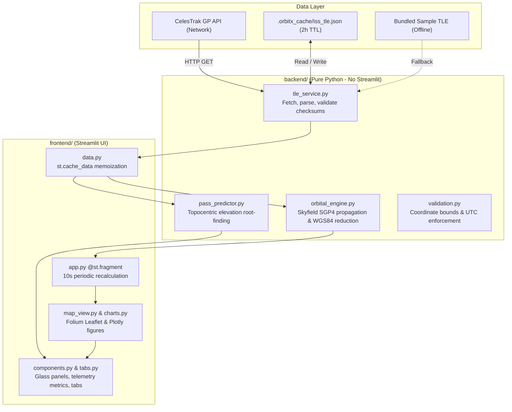

# OrbitX ISS Tracker

🚀 **OrbitX** is an educational, interactive International Space Station tracking dashboard built with Python, Streamlit, and the Skyfield/SGP4 orbital mechanics library. Designed for the GITAM Aero Astro Club (GAAC) workshop, it combines real-world astrodynamics with hands-on AI-assisted coding missions.

It requires **no API keys, no paid subscriptions, and no database infrastructure**. OrbitX retrieves public orbital elements (Two-Line Element sets) directly from CelesTrak, calculates the current and future positions of the ISS using numerical SGP4 perturbation theory, plots real-time ground tracks on an interactive map, renders telemetry charts, and predicts observer pass opportunities for any coordinate on Earth.


*Screenshots reflect actual application captures (shown with default dark glass theme; an optional looping ISS background video can be enabled locally).*

> **Educational Disclaimer:** OrbitX is an educational tool developed for university workshops and space-enthusiast learning. It is not designed for orbital collision avoidance, satellite operations, or safety-critical mission navigation. See [Scientific Principles & Limitations](#scientific-principles--limitations).

---

## Key Features

- **Live & Dynamic Orbital Calculations:** Calculates sub-satellite geodetic latitude, longitude, WGS84 altitude, and inertial orbital speed in real time.
- **Configurable Periodic Refresh:** Powered by native Streamlit fragments (`@st.fragment`), the dashboard automatically recalculates the position and updates the map marker at configurable intervals (10s recommended default, 5s, 30s, 60s, or Paused) without page flickers or widget resets.
- **Honest Provenance & Freshness Badges:** Clearly tags data as **● LIVE** (real-time CelesTrak download), **● CACHED** (local 2-hour courtesy cache), or **● SAMPLE** (bundled offline fallback, *not live*), displaying element age and automated warnings when elements are stale (>3 days) or expired (>14 days).
- **Interactive Leaflet / Folium Map:** Displays the ISS sub-satellite position, custom observer location, and projected 90-to-720-minute ground tracks, cleanly segmented across the ±180° antimeridian without visual wrapping artefacts.
- **Offline Resilient:** If internet access is unavailable or OpenStreetMap tile servers are unreachable, OrbitX falls back smoothly to a built-in Plotly ground-track chart and bundled sample orbital elements.
- **Telemetry Analysis & Export:** Visualises latitude, longitude, and ellipsoidal altitude across the orbital period. Includes one-click CSV export tagged with provenance (`orbitx_track.csv` for fresh data; `orbitx_track_illustrative.csv` when running offline/sample).
- **Observer Pass Predictions:** Computes line-of-sight pass opportunities (rise time, peak elevation, set time, duration, and azimuth directions) in both UTC and Indian Standard Time (IST).
- **Five Guided Student Missions:** Embedded mission guides (`missions/*.md`) in the dashboard with starter exercises, AI prompts, and verification steps.
- **Clean Architecture & Dark Glass Theme:** Separated into a decoupled `backend/` (pure Python mathematics, zero Streamlit imports) and `frontend/` (Streamlit presentation, responsive glassmorphism UI).

---

## Architecture & Data Flow



---

## Technology Stack

The stack is intentionally minimal and uses open-source libraries:

| Component | Library / Tool | Verified Version | Purpose |
| :--- | :--- | :--- | :--- |
| **Language** | Python | `>= 3.10` (tested on 3.10, 3.11, 3.13) | Core runtime |
| **Astrodynamics** | Skyfield & SGP4 | `skyfield >= 1.49`, `sgp4 >= 2.27` | Orbit propagation & coordinate frames |
| **Numerical Engine**| NumPy & pandas | `numpy >= 1.24`, `pandas >= 2.0` | Vectorised calculations & telemetry tabular data |
| **Dashboard UI** | Streamlit | `streamlit >= 1.50` | Interactive web application & reactive fragments |
| **Mapping** | Folium & streamlit-folium | `folium >= 0.15`, `streamlit-folium >= 0.20` | Interactive Leaflet map with ISS ground tracks |
| **Plotting** | Plotly | `plotly >= 5.18` | Telemetry series & offline ground-track charts |
| **HTTP Client** | Requests | `requests >= 2.31` | CelesTrak TLE retrieval with timeout handling |
| **Testing** | Pytest | `pytest >= 8.0` | Comprehensive unit and UI test suite (144 tests) |

---

## Prerequisites

- **Python 3.10 or newer** (Python 3.11 recommended for production deployment).
- Git.
- A modern web browser (Google Chrome, Firefox, Microsoft Edge, or Safari).

---

## Quickstart & Local Setup

### Windows (Automated PowerShell Script)

Clone the repository and run the setup script:

```powershell
git clone https://github.com/SreyasM24/OrbitX-ISS-Tracker.git
cd OrbitX-ISS-Tracker
.\scripts\setup.ps1
.\scripts\run.ps1
```

- `setup.ps1` creates `.venv`, installs dependencies from `requirements-dev.txt`, installs OrbitX in editable mode, and verifies imports without requiring administrator rights.
- `run.ps1` starts Streamlit on `http://localhost:8501` and opens your default browser.
- Additional launcher options:
  - `.\scripts\run.ps1 -Offline` (forces offline mode using cached or sample data)
  - `.\scripts\run.ps1 -Port 8502` (custom port if 8501 is busy)
  - `.\scripts\run.ps1 -NoBrowser` (starts headless without opening browser)

### Manual Setup (Windows, macOS, Linux)

```bash
# 1. Clone repository
git clone https://github.com/SreyasM24/OrbitX-ISS-Tracker.git
cd OrbitX-ISS-Tracker

# 2. Create and activate virtual environment
python3 -m venv .venv
# On Windows PowerShell:
# .\.venv\Scripts\Activate.ps1
# On macOS/Linux:
source .venv/bin/activate

# 3. Install dependencies
pip install --upgrade pip
pip install -r requirements-dev.txt
pip install -e . --no-deps

# 4. Launch application
streamlit run frontend/app.py
```

Open `http://localhost:8501` in your browser.

---

## Configuration & Environment Variables

OrbitX works out of the box with zero configuration. For advanced workshop setups or network proxy environments, optional overrides are supported via environment variables:

| Variable | Default Value | Description |
| :--- | :--- | :--- |
| `ORBITX_OFFLINE` | `0` (or unset) | Set to `1` to disable all outbound network requests. |
| `ORBITX_TLE_URL` | CelesTrak NORAD 25544 endpoint | Custom URL for orbital elements. |
| `ORBITX_HTTP_TIMEOUT_S` | `8.0` | Timeout in seconds for external CelesTrak requests. |
| `ORBITX_CACHE_TTL_S` | `7200` (2 hours) | Courtesy cache validity period before re-downloading. |
| `ORBITX_CACHE_DIR` | `.orbitx_cache` | Directory path for local disk cache. |
| `ORBITX_BACKGROUND_VIDEO` | `frontend/assets/iss-background.mp4` | Path to optional background video file. |

A template file [`.env.example`](.env.example) is provided in the repository root for reference.

---

## Data Retrieval, Caching & Refresh Lifecycle

OrbitX respects external infrastructure and client bandwidth through a 4-tier retrieval hierarchy:

1. **Streamlit In-Memory Cache (5 Minutes):** `@st.cache_data(ttl=300)` prevents redundant disk checks or network polling when students adjust UI sliders or switch tabs.
2. **Local Courtesy Disk Cache (2 Hours):** Downloaded elements are atomically cached to `.orbitx_cache/iss_tle.json`. In accordance with CelesTrak's guidelines, fresh downloads are bypassed within 2 hours unless the user explicitly clicks **↻ Re-download orbital elements**.
3. **Live Network Fetch:** Queries CelesTrak (`https://celestrak.org/NORAD/elements/gp.php?CATNR=25544&FORMAT=TLE`) with an 8-second timeout, validating the NORAD catalogue ID (25544), line checksums, and satellite name.
4. **Bundled Offline Fallback:** If internet is unavailable and no cache exists, OrbitX seamlessly loads `backend/data/sample_iss.tle`, marks the status as **SAMPLE**, and presents clear user-facing warnings that calculations are illustrative.
5. **Display Refresh vs. Network Fetch:** The dashboard timer recalculates the SGP4 orbital state vector locally (takes ~2 ms CPU time). Recalculating positions does **not** trigger external network requests.

---

## Scientific Principles & Limitations

- **Coordinate Frames:**
  - Latitude and Longitude are geodetic coordinates referenced to the **WGS84 reference ellipsoid** ($a = 6378.137\text{ km}$, $1/f = 298.257223563$).
  - Altitude is the true geometric height above the WGS84 ellipsoid computed via Bowring's closed-form reduction (`wgs84.height_of(geocentric)`).
  - Orbital speed is the inertial velocity magnitude relative to the Geocentric Celestial Reference System (GCRS) ($|\vec{v}_{GCRS}| \approx 7.66\text{ km/s}$), distinct from the ground-track speed relative to Earth's rotating surface ($\approx 7.2\text{ km/s}$).
- **Propagation Model:** Uses the standard Simplified General Perturbations 4 (SGP4) model. SGP4 accounts for Earth oblateness ($J_2, J_3, J_4$), atmospheric drag, and lunar/solar gravitational perturbations.
- **Accuracy Degeneration:** Low Earth Orbit predictions degrade over time due to atmospheric density variations and unmodelled station thruster reboosts. OrbitX displays age warnings for elements $>3$ days old.
- **Pass Geometry vs. Visibility:** Predicted passes are purely geometric (line-of-sight elevation > threshold). Visual naked-eye observation requires that the station be sunlit while the observer is in twilight/darkness with clear skies.

---

## Testing & Quality Assurance

OrbitX maintains a comprehensive test suite covering scientific calculations, coordinate conversions, TLE parsing, edge cases, cache invalidation, and UI component rendering:

```bash
# Run complete test suite
python -m pytest -q

# Run with coverage report
python -m pytest --cov=backend --cov=frontend tests/
```

### Verified Audit Results

- **Test Suite Status:** **144 passed** (0 failures, 0 errors in 59.16s).
- **Dependency Health (`pip check`):** No broken requirements or version conflicts.
- **Security Vulnerability Scan (`pip-audit`):** **0 known vulnerabilities** found in production and development dependencies.
- **Independent SGP4 Verification:** Sub-satellite positions match raw independent mathematical propagation to within $< 2.4\text{ mm}$ surface error and $\sim 1\text{ mm}$ altitude error.

---

## Deployment Guide

### Recommended Platform: Streamlit Community Cloud

OrbitX is optimised for direct deployment on **Streamlit Community Cloud** (no separate backend server or persistent volume required):

1. **Fork or Push:** Ensure your repository is on GitHub with a clean `main` branch.
2. **Sign In:** Go to [share.streamlit.io](https://share.streamlit.io) and connect your GitHub account.
3. **Deploy App:**
   - **Repository:** `SreyasM24/OrbitX-ISS-Tracker`
   - **Branch:** `main`
   - **Main file path:** `frontend/app.py`
   - **App URL:** Choose an available custom subdomain (e.g. `orbitx-iss-tracker.streamlit.app`).
4. **Advanced Settings (Optional):**
   - Python version is automatically detected as `3.11` via `.python-version`.
   - No secret environment variables or tokens are required.
5. **Launch:** Click **Deploy!** The cloud builder installs dependencies from `requirements.txt` and starts the app in approximately 1 to 2 minutes.

### Alternative Platform: Render (Python Web Service)

If hosting on Render:
- **Service Type:** Web Service (Python).
- **Build Command:** `pip install -r requirements.txt && pip install -e . --no-deps`
- **Start Command:** `streamlit run frontend/app.py --server.port $PORT --server.address 0.0.0.0 --server.headless true`
- **Storage:** Ephemeral disk is completely adequate; persistent disks are not required.

> **Note on Vercel:** Vercel is designed for serverless functions (Node.js/Python serverless) and cannot sustain the persistent, bidirectional WebSocket connections required by Streamlit's reactive engine. Do not deploy Streamlit directly to Vercel without a full frontend rewrite.

---

## Security & Repository Hygiene

- **Zero Secrets / API Keys:** OrbitX uses exclusively open, unauthenticated public science endpoints. No tokens, database passwords, or private credentials exist or are required.
- **Input Validation:** User coordinates, search windows, and custom names are rigorously sanitised and bounded in [`backend/validation.py`](backend/validation.py).
- **Execution Safety:** No dynamic `eval()`, `exec()`, `pickle`, or arbitrary shell execution primitives are used anywhere in runtime code.
- **File System Protection:** Cache file operations use atomic staging (`.tmp` write followed by `os.replace`) with fallback error handling so read-only filesystems do not cause crashes.
- **Git Hygiene:** Local caches (`.orbitx_cache/`), virtual environments (`.venv/`), temporary files, test outputs, and large untracked media files (`*.mp4`) are strictly excluded in [`.gitignore`](.gitignore).

---

## Troubleshooting

| Symptom | Cause | Solution |
| :--- | :--- | :--- |
| `ModuleNotFoundError: No module named 'backend'` | Virtual environment not active or package not installed in editable mode | Activate `.venv` and run `pip install -e . --no-deps`. |
| Port 8501 is already in use | Another application or previous Streamlit process is running | Run `.\scripts\run.ps1 -Port 8502` or terminate the lingering process. |
| Status shows **SAMPLE · bundled offline file** | No network connection or CelesTrak is temporarily unreachable | Expected offline fallback. The app functions normally with sample data. |
| Map tiles are grey or empty | OpenStreetMap tile servers are blocked or internet is disconnected | Open the expander **"Plain track plot (works without internet)"** to view the Plotly track. |
| Background video does not appear | Background video is optional and not tracked in Git | Place an H.264 video at `frontend/assets/iss-background.mp4` (see [assets README](frontend/assets/README.md)). |
| `DeprecationWarning: Setting the dtype on a NumPy array...` | Upstream warning from Skyfield 1.55 on NumPy 2.5+ | Harmless upstream library warning; does not affect numerical calculation accuracy. |

---

## Student Workshop & Mission Guides

OrbitX includes five structured missions for classroom pairs:

1. [Mission 1 · Where Is the ISS?](missions/mission-1.md) (20 min) — Understand coordinates, units, and orbital speed.
2. [Mission 2 · Put the ISS on a Map](missions/mission-2.md) (20 min) — Visualise subpoints, ground tracks, and map projections.
3. [Mission 3 · Where Will It Be?](missions/mission-3.md) (25 min) — Orbital period calculations, ground-track propagation, and antimeridian splitting.
4. [Mission 4 · Can We See It?](missions/mission-4.md) (15 min) — Topocentric pass predictions, elevation thresholds, and azimuth angles.
5. [Final Challenge · New City Challenge](missions/final-challenge.md) (10 min) — Register a new ground station and verify local pass schedules.

Facilitators running classroom sessions should consult the comprehensive [FACILITATOR_GUIDE.md](FACILITATOR_GUIDE.md).

---

## Contributing

Contributions are welcome! Please read [CONTRIBUTING.md](CONTRIBUTING.md) for architecture rules, code standards, and pull request procedures. All code changes must include tests and maintain scientific transparency.

---

## Attribution & License

- **Orbital Elements:** Courtesy of [CelesTrak](https://celestrak.org/) (Dr. T.S. Kelso).
- **Orbit Propagation & Reduction:** [Skyfield](https://rhodesmill.org/skyfield/) & Brandon Rhodes; SGP4 by Daniel Warner and contributors.
- **Cartography:** Base map data © [OpenStreetMap](https://www.openstreetmap.org/copyright) contributors.
- **License:** OrbitX code is released under the [MIT License](LICENSE).
- **Community:** Developed for the **GITAM Aero Astro Club (GAAC)**, GITAM University.
