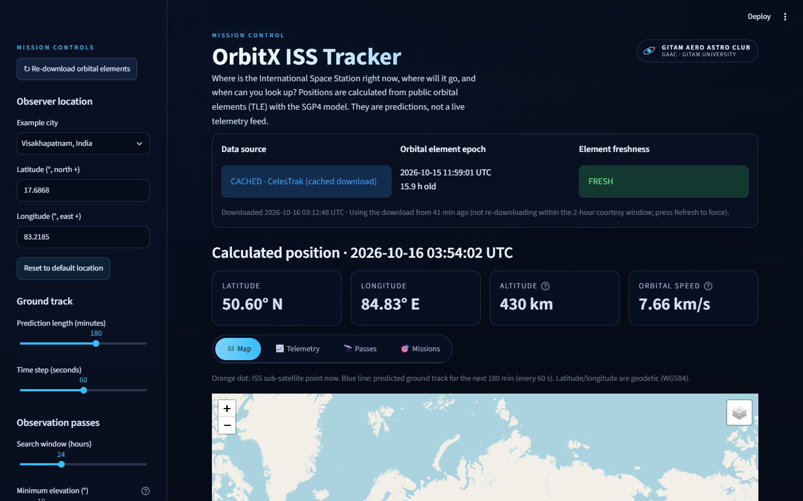
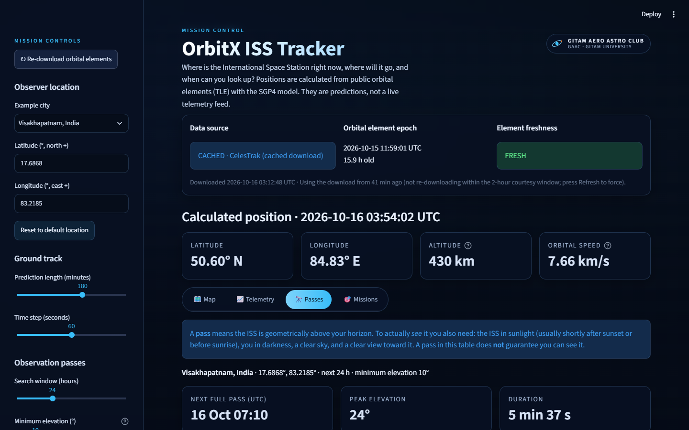

# OrbitX ISS Tracker

🚀 OrbitX is a hands-on space-tech workshop where you build an interactive ISS tracker using Python, orbital mechanics and AI-assisted coding: explore satellite positions, visualise orbital trajectories and predict ISS passes over different locations.

This repository is a small, beginner-friendly **International Space Station tracker** built for the OrbitX workshop run by the GITAM Aero Astro Club (21 October 2026, 3 – 5 PM IST). Pairs of students use it as a base for five short missions that mix space science with AI-assisted coding.

It needs **no API key and no paid service**. It downloads public orbital elements, calculates where the ISS is and will be, shows that on a map and in charts, and predicts when it passes over a chosen place.





*Screenshots are real captures of the app (shown without the optional background video, see [Background video](#background-video)).*

> OrbitX is an educational tool. It is not a navigation, safety or scientific-grade tracking system. See [Scientific limitations](#scientific-limitations).

## Features

- Current ISS latitude, longitude, altitude and orbital speed, calculated from orbital elements (not copied from a live feed).
- Honest data labelling: **LIVE** (downloaded now), **CACHED** (last download), or **SAMPLE** (bundled offline file, *not* live), plus element epoch, age and a freshness warning.
- Interactive map (Folium) with the predicted ground track, correctly split at the ±180° line.
- Telemetry charts (Plotly): latitude, longitude and altitude against UTC time.
- Observation-pass table for any location: rise, peak, set, duration, peak elevation and compass directions, in UTC and IST.
- Example cities (Visakhapatnam by default) or your own validated latitude/longitude.
- A premium "mission control" interface: dark glass panels, pill tabs, keyboard-visible focus, responsive layout, and an optional looping ISS video behind the dashboard.
- Five guided missions with starter code, AI-prompt suggestions and verification steps (`missions/`).
- The core dashboard keeps working without internet, using the cache or the bundled sample. The street map and its scripts need internet; a plain track plot is the offline substitute (see [Offline mode](#offline-mode)).

**Stack:** Python, [Skyfield](https://rhodesmill.org/skyfield/) (SGP4 propagation and coordinates), Streamlit, Folium + streamlit-folium, Plotly, pandas, requests. Tests use pytest.

## Repository structure

```
app.py                      Streamlit entry point: wires data, calculations and UI together
src/orbitx/
  config.py                 Constants, thresholds, example cities
  models.py                 Typed dataclasses (TleRecord, Observer, SatellitePass, ...)
  validation.py             Input validation, UTC helpers, TLE checksum
  tle_service.py            TLE download, parsing, caching, offline fallback (only module using the network)
  orbital_engine.py         Skyfield propagation, ground track, antimeridian handling
  pass_predictor.py         Observer passes, pass table
  map_view.py               Folium map
  charts.py                 Plotly telemetry charts
  formatting.py             Display formatting
  missions.py               Mission registry and required-section contract
  ui/                       Streamlit presentation only (no orbital maths)
    theme.py                  Stylesheet (CSS)
    background.py / .js       Background video layer and seamless-loop script
    components.py             Header, status panel, telemetry cards, footer
    sidebar.py                Observer, ground-track and pass controls
    tabs.py                   Map, Telemetry, Passes and Missions tabs
    data.py                   st.cache_data wrappers
missions/                   Five mission guides (Markdown)
data/sample_iss.tle         Bundled offline sample orbital elements
assets/                     Optional local background video (not in the repo; see assets/README.md)
docs/                       ARCHITECTURE.md, TROUBLESHOOTING.md, screenshots
tests/                      pytest suite (no network needed)
scripts/setup.ps1           Windows one-time setup
scripts/run.ps1             Windows launcher
FACILITATOR_GUIDE.md        For workshop organisers
CONTRIBUTING.md             How to contribute
```

## Requirements

- **Python 3.10 or newer.** Developed and tested on Python 3.13.13 (Windows 11). Other versions are expected to work but have not been tested.
- Internet access for the first dependency install, and (optionally) for live orbital elements and map tiles.

## Setup on Windows (PowerShell)

From the repository folder:

```powershell
.\scripts\setup.ps1
.\scripts\run.ps1
```

`setup.ps1` creates `.venv` only if it is missing, installs `requirements-dev.txt`, installs OrbitX in editable mode and checks the imports. It does not need administrator rights. `run.ps1` works from any directory, starts the app with the project's own `.venv` and opens `http://localhost:8501`.

Options: `.\scripts\run.ps1 -Offline` (no network), `-Port 8502`, `-NoBrowser`; `.\scripts\setup.ps1 -Recreate` rebuilds `.venv`.

If PowerShell says that running scripts is disabled, either use the manual steps below, or allow local scripts for your own user (a normal, non-administrator setting you can decide on yourself): `Set-ExecutionPolicy -Scope CurrentUser RemoteSigned`.

### Manual setup (Windows)

```powershell
py -3 -m venv .venv
.\.venv\Scripts\Activate.ps1
pip install -r requirements-dev.txt
pip install -e .
streamlit run app.py
```

## Setup on macOS / Linux

These steps use standard Python tooling; they have **not** been tested on macOS or Linux by the authors.

```bash
python3 -m venv .venv
source .venv/bin/activate
pip install -r requirements-dev.txt
pip install -e .
streamlit run app.py
```

## Background video

OrbitX can play a muted, looping ISS video behind the dashboard. **The video is not included in this repository**: the stock footage used by the maintainers has no confirmed redistribution licence. Without it you see a dark navy gradient and everything else works.

To enable it, put a video you are allowed to use at `assets/iss-background.mp4` (or set `ORBITX_BACKGROUND_VIDEO`) and restart the app. Details and tips: [assets/README.md](assets/README.md). The video keeps playing when you switch tabs or change settings; it is a fixed layer that Streamlit does not re-create on reruns, and the end of the clip is crossfaded into its start.

## Club branding

The header carries a small **GITAM AERO ASTRO CLUB / GAAC · GITAM UNIVERSITY** attribution badge with a generic orbit icon (it is not an official logo). OrbitX remains the primary product.

## Virtual environment

Activate it before running Python commands yourself: `.\.venv\Scripts\Activate.ps1` (Windows) or `source .venv/bin/activate` (macOS/Linux). Your prompt shows `(.venv)`. To check, run `python -c "import sys; print(sys.executable)"`; the path must end in `.venv\Scripts\python.exe` (or `.venv/bin/python`). Leave with `deactivate`.

## Running the tests

```powershell
python -m pytest
```

The suite makes no network requests and does not depend on the ISS's current position (the clock is fixed in UI tests). The UI tests use Streamlit's `AppTest`, which runs the script headlessly and does not open a browser. The redesigned interface was additionally driven by hand-written Playwright scripts in Google Chrome on Windows 11 (all tabs, city and invalid-input handling, CSV download, 1440 px and 390 px widths, video continuity across reruns). Those browser checks are not part of the automated suite, so please also do a quick visual run yourself.

## Offline mode

OrbitX never fails just because the network does:

1. A recent cached download (`.orbitx_cache/iss_tle.json`, valid for 2 hours) is reused.
2. Otherwise it downloads from CelesTrak.
3. If that fails it uses the last cached download, however old.
4. If there is no cache it uses `data/sample_iss.tle` and labels the data **SAMPLE, NOT live**.

To force offline behaviour: `.\scripts\run.ps1 -Offline`, or set `ORBITX_OFFLINE=1`. **The Folium map needs internet twice over:** its street tiles come from OpenStreetMap and its JavaScript libraries from public CDNs. If only the tiles are blocked you see the track on a grey background; with no internet at all the map area stays empty. In that case open **Plain track plot (works without internet)** under the map: it draws the same predicted track with Plotly, which ships inside Streamlit. Telemetry charts, metrics, pass table and missions work fully offline. The very first `setup.ps1` still needs internet to install packages. Other settings are in `.env.example` (they are plain environment variables; no `.env` loader is built in).

Sample data ages: positions from a sample that is weeks old are only illustrative, and the app says so.

## Mission guides

| # | Guide | Time |
| --- | --- | --- |
| 1 | [Where Is the ISS?](missions/mission-1.md) | 20 min |
| 2 | [Put the ISS on a Map](missions/mission-2.md) | 20 min |
| 3 | [Where Will It Be?](missions/mission-3.md) | 25 min |
| 4 | [Can We See It?](missions/mission-4.md) | 15 min |
| 5 | [New City Challenge](missions/final-challenge.md) | 10 min |

The guides also appear in the app's **Missions** tab. The core app works before any mission starts; each mission asks for one small code change. Organisers: see [FACILITATOR_GUIDE.md](FACILITATOR_GUIDE.md).

## Contributing

See [CONTRIBUTING.md](CONTRIBUTING.md) for where UI, scientific and data code belongs, how to add a mission and how to open a pull request. [docs/ARCHITECTURE.md](docs/ARCHITECTURE.md) explains the data flow; [docs/TROUBLESHOOTING.md](docs/TROUBLESHOOTING.md) lists common problems.

## Git and GitHub workflow

Clone the workshop repository (or your fork of it):

```powershell
git clone https://github.com/SreyasM24/OrbitX-ISS-Tracker.git
cd OrbitX-ISS-Tracker
git switch -c my-pair-name        # work on your own branch
# ... edit, run the app, run the tests ...
git status
git add src/orbitx/formatting.py app.py     # add the files you changed, not everything
git commit -m "Mission 1: show altitude in miles"
git push -u origin my-pair-name
```

If something breaks, `git diff` shows what changed and `git checkout -- <file>` restores one file from the last commit. Do not commit `.venv/`, `.orbitx_cache/`, `static/` or video files (they are in `.gitignore`).

## Troubleshooting

| Problem | Fix |
| --- | --- |
| `ModuleNotFoundError: No module named 'orbitx'` | Activate `.venv`, then `pip install -e .`. Check with `python -c "import orbitx"`. |
| `python` is not recognised / opens the Microsoft Store | Install Python 3.10+ from python.org with "Add python.exe to PATH", open a new terminal, retry. |
| PowerShell blocks `setup.ps1` | See the execution-policy note above, or use the manual steps. |
| `pip install` fails or hangs | Check the internet connection or a proxy (`pip install --proxy http://host:port ...`). |
| Page says **SAMPLE, NOT live** | You are offline, or CelesTrak could not be reached. This is a deliberate, honest fallback. |
| Port 8501 is busy | `.\scripts\run.ps1 -Port 8502`. |
| Browser does not open | Open `http://localhost:8501` yourself. |
| No video background | Expected unless you add `assets/iss-background.mp4` (see [Background video](#background-video)). |
| Map is grey | Map tiles need internet. The ISS marker and track still draw. |
| Map area is completely empty | The map's scripts also need internet. Use the **Plain track plot** expander below it. |
| Edited code, page unchanged | Save the file, then use **Rerun** in the Streamlit menu (or press **R**). |
| `DeprecationWarning ... Setting the dtype on a NumPy array` | Raised inside Skyfield 1.55 under NumPy 2.5. It does not change results. A future Skyfield update should remove it; it is not suppressed here so you can see it. |
| Windows Firewall prompt | Allowing private-network access for Python lets the browser reach `localhost`. |

## Scientific limitations

- **Accuracy.** Positions come from the SGP4 model applied to public orbital elements (TLE). They are good for educational use, but error grows the further the requested time is from the element epoch (commonly kilometres per day for low-orbit objects). The ISS also fires thrusters for reboosts and debris avoidance, which an old TLE does not know about. The app warns when elements are stale (older than 3 days) or expired (older than 14 days), and when you request times far from the epoch.
- **Passes are geometric.** A "pass" means the ISS is above your horizon. Seeing it also needs the ISS in sunlight, you in darkness (roughly the hours after sunset or before sunrise), clear sky and an open view. OrbitX does not yet check twilight or cloud, and does not model atmospheric refraction.
- **Frames and units.** Latitude, longitude and altitude are geodetic (WGS84), altitude being the height above the ellipsoid. Orbital speed is relative to Earth's centre in a non-rotating frame (about 7.7 km/s), not the speed of the ground point.
- **Time.** All calculations use UTC. IST (UTC+05:30) is shown for convenience only.
- **City coordinates** are approximate city-centre values (about 0.01° precision), fine for pass prediction, not for surveying.

## Data attribution and licence

- Orbital elements: [CelesTrak](https://celestrak.org/) general-perturbations data for the ISS (NORAD 25544). Please follow CelesTrak's usage guidance; OrbitX reuses a download for 2 hours and caches it. `data/sample_iss.tle` is one such element set, with its retrieval date in the file header.
- Propagation and coordinates: Skyfield and the `sgp4` package. Map data and tiles: © OpenStreetMap contributors, subject to the OpenStreetMap tile usage policy.
- OrbitX's own code is released under the [MIT License](LICENSE). It does not include third-party source code; dependencies (for example Skyfield and Folium under MIT, Streamlit and requests under Apache-2.0, pandas and NumPy under BSD-style licences) are installed separately under their own licences.
- The optional background video is **not** covered by the MIT licence and is not distributed here; any video you add remains under its own licence.
