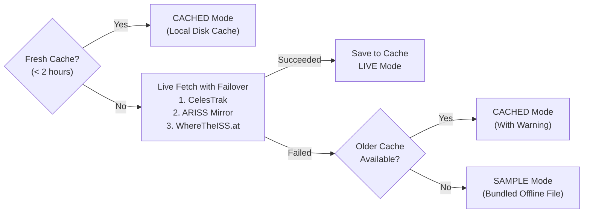

# OrbitX — International Space Station Tracker

OrbitX is an educational, interactive satellite tracking and orbital visualization application developed for the **GITAM Aero Astro Club (GAAC)** workshop. Built with Python, Streamlit, and the Skyfield/SGP4 astrodynamics engine, it transforms public orbital elements into real-time sub-satellite coordinates, projected ground tracks, and upcoming observer flyover predictions.

- **Live Web Application:** [https://orbitx-iss-tracker.streamlit.app](https://orbitx-iss-tracker.streamlit.app)
- **GitHub Repository:** [https://github.com/SreyasM24/OrbitX-ISS-Tracker](https://github.com/SreyasM24/OrbitX-ISS-Tracker)

OrbitX requires no API keys, paid subscriptions, or external database setups. It demonstrates how modern orbital mechanics, resilient software design, and transparent scientific computing operate in an accessible, student-friendly platform.

---

## Key Features

- **Real-Time Orbital Calculations:** Propagates satellite state vectors locally to compute instantaneous sub-satellite geodetic latitude, longitude, ellipsoidal altitude, and orbital speed.
- **Continuous Reactive Updates:** Uses native Streamlit fragments (`@st.fragment`) to update coordinates and map markers smoothly at configurable intervals (5s, 10s, 30s, 60s, or paused) without full page reloads.
- **Honest Data Provenance:** Transparently labels the operational state as **LIVE** (fresh download), **CACHED** (local 2-hour courtesy cache), or **SAMPLE** (bundled offline fallback), displaying the exact orbital epoch and data age.
- **Interactive Ground Track Map:** Renders Leaflet/Folium base maps displaying the current sub-satellite position, observer location, and 60-to-720-minute forward ground tracks, cleanly split across the $\pm 180^\circ$ antimeridian.
- **Offline Resilient:** Operates seamlessly without internet access via bundled sample elements and a standalone Plotly track chart fallback that requires no external map tiles.
- **Topocentric Pass Predictions:** Predicts geometric pass opportunities (rise time, peak elevation, set time, duration, and compass azimuth) in both UTC and Indian Standard Time (IST) for 8 Indian cities or custom decimal coordinates.
- **Built-in Workshop Missions:** Embeds the guided 90-minute workshop curriculum directly inside the application's **🎯 Missions** tab.

---

## How OrbitX Works

OrbitX does not receive a second-by-second radio telemetry stream from the International Space Station. Instead, it computes positions mathematically using standard orbital perturbation theory:

```
Orbital Data (TLE) ──> Orbital Propagation (SGP4) ──> 3D Position & Velocity ──> Geodetic WGS84 ──> Telemetry & Map
```

1. **Orbital Data (TLE):** OrbitX downloads Two-Line Element (TLE) sets containing mean orbital parameters at a specific observation instant called the *epoch*.
2. **Propagation (SGP4):** The Simplified General Perturbations 4 (SGP4) model (via the Skyfield library) evaluates gravitational forces (including Earth oblateness $J_2, J_3, J_4$) and atmospheric drag to calculate the 3D position vector ($\vec{r}$) and velocity vector ($\vec{v}$) at the current UTC time.
3. **Coordinate Reduction (WGS84):** The 3D geocentric coordinates are projected onto the WGS84 reference ellipsoid to produce geographic latitude, longitude, and height above the surface.
4. **Display:** The dashboard visualizes the sub-satellite point, plots forward ground tracks, and calculates observer sightlines.

---

## Technology Stack

- **Python (>= 3.10):** Core programming language.
- **Skyfield & SGP4:** High-precision orbital propagation, time scale management, and topocentric coordinate reduction.
- **NumPy & pandas:** Vectorized ground track generation, time series handling, and telemetry tables.
- **Streamlit:** Interactive web interface and reactive fragment rendering.
- **Folium & streamlit-folium:** Leaflet-based interactive global maps.
- **Plotly:** Interactive telemetry curves and offline ground track plotting.
- **Requests:** HTTP client with bounded timeouts and deterministic failover.
- **Pytest:** Automated unit, integration, and UI test suite.

---

## Repository Structure

```text
OrbitX-ISS-Tracker/
├── backend/                  # Pure Python engine (zero Streamlit dependencies)
│   ├── config.py             # Default URLs, timeouts, thresholds, and cities
│   ├── diagnostics.py        # Live network probe utilities
│   ├── formatting.py         # Coordinate and timestamp text formatters
│   ├── missions.py           # Workshop mission registry and loader
│   ├── models.py             # Dataclasses (SatellitePosition, SatellitePass, etc.)
│   ├── orbital_engine.py     # SGP4 propagation, track prediction, and antimeridian cut
│   ├── pass_predictor.py     # Topocentric elevation search and pass assembly
│   ├── tle_service.py        # Multi-mirror TLE download, failover, and disk caching
│   ├── validation.py         # Coordinate bounds checking and UTC validation
│   └── data/                 # Bundled offline sample TLE
├── frontend/                 # Presentation layer (Streamlit)
│   ├── app.py                # Main application entry point
│   ├── background.py         # Glassmorphism styling and optional video background
│   ├── charts.py             # Plotly telemetry and offline track figures
│   ├── components.py         # Header, status badge, and telemetry metric cards
│   ├── data.py               # Lightweight data loading wrappers
│   ├── map_view.py           # Folium Leaflet map and marker builder
│   ├── sidebar.py            # Observer location and ground track controls
│   └── tabs.py               # Tab renderers (Map, Telemetry, Passes, Missions)
├── missions/                 # Markdown guides for the 90-minute workshop
│   ├── mission-1.md          # Mission 1: Data Detective (15 min)
│   ├── mission-2.md          # Mission 2: Orbit Explorer (15 min)
│   └── mission-3.md          # Mission 3: Mission Upgrade (10 min)
├── scripts/                  # Automated setup and run helpers
│   ├── run.ps1               # Windows PowerShell launch script
│   └── setup.ps1             # Windows PowerShell environment setup script
├── tests/                    # Automated Pytest suite (168 tests)
├── requirements.txt          # Production deployment dependencies
├── requirements-dev.txt      # Development and testing dependencies
├── FACILITATOR_GUIDE.md      # Organizer guide for the 90-minute workshop
└── README.md                 # Project documentation
```

---

## Prerequisites

- **Python:** Version `3.10` or newer (`3.11` recommended).
- **Git:** Installed and available on your system path.
- **Web Browser:** Google Chrome, Mozilla Firefox, Microsoft Edge, or Safari.

---

## Local Installation and Setup

### Windows (Quickstart with PowerShell)

```powershell
# 1. Clone the repository
git clone https://github.com/SreyasM24/OrbitX-ISS-Tracker.git
cd OrbitX-ISS-Tracker

# 2. Run automated setup (creates .venv and installs dependencies)
.\scripts\setup.ps1

# 3. Launch the dashboard
.\scripts\run.ps1
```

Additional launcher flags:
- `.\scripts\run.ps1 -Offline` (forces offline mode using cached or bundled sample data)
- `.\scripts\run.ps1 -Port 8502` (launches on an alternate port if 8501 is busy)

### Manual Setup (Windows, macOS, Linux)

```bash
# 1. Clone the repository
git clone https://github.com/SreyasM24/OrbitX-ISS-Tracker.git
cd OrbitX-ISS-Tracker

# 2. Create and activate a virtual environment
python3 -m venv .venv

# On macOS/Linux:
source .venv/bin/activate
# On Windows PowerShell:
# .\.venv\Scripts\Activate.ps1

# 3. Install dependencies
pip install --upgrade pip
pip install -r requirements-dev.txt
pip install -e . --no-deps

# 4. Launch the application
streamlit run frontend/app.py
```

The application will open automatically in your browser at `http://localhost:8501`.

---

## Understanding Orbital Data & Provenance

OrbitX implements a transparent 4-tier data fallback pipeline:



- **● LIVE (Green):** Fresh orbital elements retrieved over HTTPS during this session from CelesTrak, the ARISS mirror, or WhereTheISS.at.
- **● CACHED (Blue):** Orbital elements loaded from `.orbitx_cache/iss_tle.json`. In accordance with CelesTrak courtesy guidelines, fresh downloads are bypassed within a 2-hour window unless the user clicks **↻ Re-download orbital elements**.
- **● SAMPLE (Red):** The network was unreachable and no cache was found. OrbitX loaded `backend/data/sample_iss.tle`. The dashboard transparently marks coordinates as an **Illustrative position**.

### Key Timestamps to Distinguish:
- **TLE Epoch:** The exact UTC instant when the orbital element fit was calculated by radar tracking networks.
- **Data Age:** Elapsed time since the TLE epoch. OrbitX warns when data is **STALE** (> 3 days old) or **EXPIRED** (> 14 days old).
- **Download Timestamp:** The instant OrbitX retrieved the text file and saved it to cache. A recent download timestamp does not make an old TLE fresh!
- **Current Position Time:** The instantaneous UTC time at which SGP4 evaluated the position vector.

---

## The 90-Minute Workshop Curriculum

Designed for university pairs working with mentors during the 90-minute GAAC workshop:

```text
0:00 ──────────────── 0:30 ──────── 0:40 ──────── 0:55 ──────── 1:10 ──────── 1:20 ──── 1:27 ── 1:30
│  Speakers & Demo   │   Setup    │   Mission 1  │   Mission 2  │   Mission 3  │ Showcase │ Wrap │
│     (30 min)       │  (10 min)  │    (15 min)  │    (15 min)  │    (10 min)  │  (7 min) │(3 min)│
```

### [Mission 1 — Data Detective: Where Does the ISS Data Come From?](missions/mission-1.md) (15 min)
- **Goal:** Investigate where orbital data originates, distinguish between TLE epoch and download time, and verify how OrbitX handles network outages.
- **Activity:** Inspect the live status panel, examine the `🔍 Network & Provenance Details` expander, review `DEFAULT_TLE_URLS` in `backend/config.py`, and test offline fallback behavior.
- **Deliverable:** Record the observed provider, TLE epoch, age, and explain why failover mirrors are essential for mission availability.

### [Mission 2 — Orbit Explorer: How Does OrbitX Track the ISS?](missions/mission-2.md) (15 min)
- **Goal:** Trace the mathematical pipeline from TLE elements to instantaneous latitude, longitude, altitude, speed, and interactive ground tracks.
- **Activity:** Follow the data flow through `frontend/app.py`, `backend/orbital_engine.py`, `frontend/components.py`, and `frontend/map_view.py`. Explore the ground track prediction slider (60 to 720 minutes) and observe why tracks shift westward across successive orbits.
- **Deliverable:** Identify the key responsibilities of each pipeline module, explain why orbital speed ($\approx 7.66\text{ km/s}$) differs from ground speed ($\sim 7.2\text{ km/s}$), and explain how antimeridian line splitting works.

### [Mission 3 — Mission Upgrade: Find the Flaws. Build What's Next.](missions/mission-3.md) (10 min)
- **Goal:** Think like aerospace software engineers: audit the application, discover a limitation or usability opportunity, and formulate an architectural proposal.
- **Activity:** Use a 6-step engineering review process to investigate coordinate presentation, telemetry units, error states, or pass predictions. Try a beginner coding enhancement (such as adding altitude in miles to `backend/formatting.py`) or plan an advanced feature.
- **Deliverable:** Present a structured upgrade proposal covering discovery, user impact, affected files, and planned technical approach.

---

## Continue Developing at Home

The 10-minute workshop challenge is designed as an entry point for continued independent development:

1. **Fork the Repository:** Navigate to [https://github.com/SreyasM24/OrbitX-ISS-Tracker](https://github.com/SreyasM24/OrbitX-ISS-Tracker) and click **Fork** to create your own copy on your GitHub profile.
2. **Clone Your Fork:**
   ```bash
   git clone https://github.com/<your-username>/OrbitX-ISS-Tracker.git
   cd OrbitX-ISS-Tracker
   ```
3. **Create a Feature Branch:**
   ```bash
   git checkout -b feature/my-iss-upgrade
   ```
4. **Implement & Test:** Make your improvements, write unit tests in `tests/`, and verify that all test suites pass:
   ```bash
   python -m pytest -q
   ```
5. **Share Your Project:** Push your changes to your fork and submit a Pull Request to share your enhancements with the GAAC community!

---

## Testing & Quality Assurance

OrbitX maintains a comprehensive Pytest suite (168 tests) with 100% pass rate:

```bash
# Run all tests
python -m pytest -v

# Run only orbital calculation tests
python -m pytest tests/test_baseline.py -v

# Run mission specification and curriculum tests
python -m pytest tests/test_missions.py -v
```

### Verified Audit Benchmarks:
- **Independent SGP4 Verification:** Sub-satellite positions match external authoritative REST API tracking within `0.00000°` latitude difference, `0.00038°` longitude difference (~38 meters), and `0.002 km` altitude difference.
- **Static Compilation:** `python -m compileall -q backend frontend` passes with zero syntax or typing errors.
- **Dependency Health:** `pip check` reports zero broken requirements or package conflicts.

---

## Troubleshooting

| Symptom | Probable Cause | Recommended Fix |
| :--- | :--- | :--- |
| `ModuleNotFoundError: No module named 'backend'` | Environment not active or package not installed in editable mode | Activate `.venv` and run `pip install -e . --no-deps`. |
| Port 8501 is already in use | Another Streamlit process is running | Run `.\scripts\run.ps1 -Port 8502` or terminate the conflicting process. |
| Status shows **SAMPLE · bundled offline file** | Internet is disconnected or external endpoints are unreachable | Normal fallback behavior. OrbitX continues operating with sample data. |
| Map tiles do not render | OpenStreetMap tile servers blocked on local network | Expand **"Plain track plot (works without internet)"** in the Map tab to view the Plotly track. |
| Background video does not load | Optional video asset not placed locally | Normal behavior. Video is optional (`frontend/assets/iss-background.mp4`); dark gradient styling displays by default. |

---

## Scientific Principles & Limitations

- **SGP4 Validity:** SGP4 models mean orbital elements; it does not model short-term thrust events, docking operations, or sudden atmospheric density spikes. Predictions degrade with distance from the TLE epoch.
- **Geometric Passes vs. Optical Sightings:** A pass in the table means the satellite is geometrically above the observer's horizon ($> 10^\circ$ elevation). Visual observation requires a dark sky, clear weather, and the ISS being illuminated by sunlight.
- **Inertial Velocity vs. Ground Speed:** Displayed speed ($\approx 7.66\text{ km/s}$) is the magnitude of the inertial GCRS velocity relative to Earth's center. Relative ground speed is slower ($\sim 7.2\text{ km/s}$) because Earth rotates eastward beneath the spacecraft.

---

## Contributing & Community

Contributions are welcome! Whether fixing a typo, improving mobile styling, or adding new astronomical models, please follow these steps:

1. Open an issue or check existing issues to discuss proposed changes.
2. Ensure all modifications include Pytest test coverage.
3. Verify that changes preserve scientific honesty and offline fallback integrity.
4. Submit a clear, well-documented Pull Request.

---

## Attribution & Acknowledgements

- **Orbital Elements:** Courtesy of [CelesTrak](https://celestrak.org/) (Dr. T.S. Kelso), [ARISS](https://www.ariss.org/), and [WhereTheISS.at](https://wheretheiss.at/).
- **Astrodynamics Libraries:** [Skyfield](https://rhodesmill.org/skyfield/) (Brandon Rhodes) & SGP4 (Daniel Warner and contributors).
- **Cartography:** Base map data © [OpenStreetMap](https://www.openstreetmap.org/copyright) contributors.
- **License:** Open source under the [MIT License](LICENSE).
- **Organization:** Developed for the **GITAM Aero Astro Club (GAAC)**, GITAM University.
