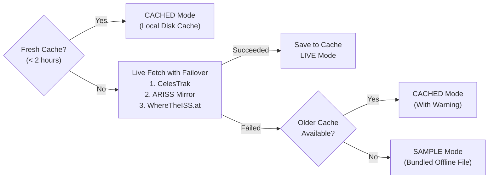

# OrbitX — International Space Station Tracker

OrbitX is an educational, interactive satellite tracking and orbital visualization application developed for the **GITAM Aero Astro Club (GAAC)** workshop. Built with Python, Streamlit, and the Skyfield/SGP4 astrodynamics engine, it transforms public orbital elements into real-time sub-satellite coordinates, projected ground tracks, and upcoming observer flyover predictions.

- **Live Web Application:** [https://orbitx-iss-tracker.streamlit.app](https://orbitx-iss-tracker.streamlit.app)
- **GitHub Repository:** [https://github.com/SreyasM24/OrbitX-ISS-Tracker](https://github.com/SreyasM24/OrbitX-ISS-Tracker)

OrbitX requires no API keys, paid subscriptions, or external database setups. It demonstrates how modern orbital mechanics, resilient software design, and transparent scientific computing operate in an accessible, student-friendly platform.

---

## Key Features

- **Real-Time Orbital Calculations:** Propagates satellite state vectors locally to compute instantaneous sub-satellite geodetic latitude, longitude, ellipsoidal altitude, and orbital speed.
- **Continuous Reactive Updates:** Uses native Streamlit fragments (`@st.fragment`) to update coordinates and map markers smoothly at configurable intervals (5s, 10s, 30s, 60s, or paused) without full page reloads.
- **Honest Data Provenance:** Transparently labels the operational state as **LIVE** (fresh download), **CACHED** (local 2-hour courtesy cache), or **SAMPLE** (bundled offline fallback), displaying the exact orbital epoch and data age.
- **Interactive Ground Track Map:** Renders Leaflet/Folium base maps displaying the current sub-satellite position, observer location, and 60-to-720-minute forward ground tracks, cleanly split across the $\pm 180^\circ$ antimeridian.
- **Offline Resilient:** Operates seamlessly without internet access via bundled sample elements and a standalone Plotly track chart fallback that requires no external map tiles.
- **Topocentric Pass Predictions:** Predicts geometric pass opportunities (rise time, peak elevation, set time, duration, and compass azimuth) in Indian Standard Time (IST, UTC+05:30) for 8 Indian cities or custom decimal coordinates.
- **Indian Standard Time (IST) Interface:** All user-facing timestamps (epoch, data age, fetch time, position time, charts, and passes) display in IST for the Indian workshop context, while internal orbital propagation strictly runs in UTC.
- **Built-in Workshop Missions:** Embeds the guided 3-mission workshop curriculum directly inside the application's **🎯 Missions** tab.
- **On-Demand Accuracy Cross-Check:** Includes an interactive sidebar tool to cross-check SGP4 mathematical predictions against external orbital propagation at the exact same UTC second.

---

## How OrbitX Works

OrbitX does not receive a direct live GPS telemetry feed from onboard the spacecraft. Instead, it computes positions mathematically using standard orbital perturbation theory:

```
Orbital Data (TLE) ──> Orbital Propagation (SGP4) ──> 3D Position & Velocity ──> Geodetic WGS84 ──> Telemetry & Map
```

1. **Orbital Data (TLE):** OrbitX downloads Two-Line Element (TLE) sets containing mean orbital parameters at a specific observation instant called the *epoch*.
2. **Propagation (SGP4):** The Simplified General Perturbations 4 (SGP4) model (via the Skyfield library) evaluates gravitational forces (including Earth oblateness $J_2, J_3, J_4$) and atmospheric drag to calculate the 3D position vector ($\vec{r}$) and velocity vector ($\vec{v}$) at the current UTC time.
3. **Coordinate Reduction (WGS84):** The 3D geocentric coordinates are projected onto the WGS84 reference ellipsoid to produce geographic latitude, longitude, and height above the surface.
4. **Display:** The dashboard visualizes the sub-satellite point, plots forward ground tracks, and calculates observer sightlines.

> **Important Distinction:** A **`LIVE`** source badge indicates successful retrieval of fresh orbital elements from the configured network endpoint (CelesTrak, ARISS, or WhereTheISS.at). It does **not** mean the displayed position is a direct onboard GPS measurement; it confirms that the mathematical model is propagating from the newest available tracking fit.

---

## Technology Stack

- **Python (>= 3.10):** Core programming language.
- **Skyfield & SGP4:** High-precision orbital propagation, time scale management, and topocentric coordinate reduction.
- **NumPy & pandas:** Vectorized ground track generation, time series handling, and telemetry tables.
- **Streamlit:** Interactive web interface and reactive fragment rendering.
- **Folium & streamlit-folium:** Leaflet-based interactive global maps.
- **Plotly:** Interactive telemetry curves and offline ground track plotting.
- **Requests:** HTTP client with bounded timeouts and deterministic failover.
- **Pytest:** Automated unit, integration, and UI test suite.

---

## Repository Structure

```text
OrbitX-ISS-Tracker/
├── backend/                  # Pure Python engine (zero Streamlit dependencies)
│   ├── config.py             # Default URLs, timeouts, thresholds, and cities
│   ├── diagnostics.py        # Live network probe utilities
│   ├── formatting.py         # Coordinate and timestamp text formatters
│   ├── missions.py           # Workshop mission registry and loader
│   ├── models.py             # Dataclasses (SatellitePosition, SatellitePass, etc.)
│   ├── orbital_engine.py     # SGP4 propagation, track prediction, and antimeridian cut
│   ├── pass_predictor.py     # Topocentric elevation search and pass assembly
│   ├── tle_service.py        # Multi-mirror TLE download, failover, and disk caching
│   ├── validation.py         # Coordinate bounds checking and UTC validation
│   └── data/                 # Bundled offline sample TLE
├── frontend/                 # Presentation layer (Streamlit)
│   ├── app.py                # Main application entry point
│   ├── background.py         # Glassmorphism styling and optional video background
│   ├── charts.py             # Plotly telemetry and offline track figures
│   ├── components.py         # Header, status badge, and telemetry metric cards
│   ├── data.py               # Lightweight data loading wrappers
│   ├── map_view.py           # Folium Leaflet map and marker builder
│   ├── sidebar.py            # Observer location and ground track controls
│   └── tabs.py               # Tab renderers (Map, Telemetry, Passes, Missions)
├── missions/                 # Markdown guides for the 90-minute workshop
│   ├── mission-1.md          # Mission 1: Data Detective (15 min)
│   ├── mission-2.md          # Mission 2: Orbit Explorer (15 min)
│   └── mission-3.md          # Mission 3: Mission Upgrade (10 min)
├── scripts/                  # Automated setup and run helpers
│   ├── run.ps1               # Windows PowerShell launch script
│   └── setup.ps1             # Windows PowerShell environment setup script
├── tests/                    # Automated Pytest suite (166 tests)
├── requirements.txt          # Production deployment dependencies
├── requirements-dev.txt      # Development and testing dependencies
├── FACILITATOR_GUIDE.md      # Organizer guide for the 90-minute workshop
└── README.md                 # Project documentation
```

---

## Prerequisites

- **Python:** Version `3.10` or newer (`3.11` recommended).
- **Git:** Installed and available on your system path.
- **Web Browser:** Google Chrome, Mozilla Firefox, Microsoft Edge, or Safari.

---

## Local Installation and Setup

### Windows (Quickstart with PowerShell)

```powershell
# 1. Clone the repository
git clone https://github.com/SreyasM24/OrbitX-ISS-Tracker.git
cd OrbitX-ISS-Tracker

# 2. Run automated setup (creates .venv and installs dependencies)
.\scripts\setup.ps1

# 3. Launch the dashboard
.\scripts\run.ps1
```

Additional launcher flags:
- `.\scripts\run.ps1 -Offline` (forces offline mode using cached or bundled sample data)
- `.\scripts\run.ps1 -Port 8502` (launches on an alternate port if 8501 is busy)

### Manual Setup (Windows, macOS, Linux)

```bash
# 1. Clone the repository
git clone https://github.com/SreyasM24/OrbitX-ISS-Tracker.git
cd OrbitX-ISS-Tracker

# 2. Create and activate a virtual environment
python3 -m venv .venv

# On macOS/Linux:
source .venv/bin/activate
# On Windows PowerShell:
# .\.venv\Scripts\Activate.ps1

# 3. Install dependencies
pip install --upgrade pip
pip install -r requirements-dev.txt
pip install -e . --no-deps

# 4. Launch the application
streamlit run frontend/app.py
```

The application will open automatically in your browser at `http://localhost:8501`.

---

## Understanding Orbital Data & Provenance

OrbitX implements a transparent 4-tier data fallback pipeline:



- **● LIVE (Green):** Fresh orbital elements retrieved over HTTPS during this session from CelesTrak, the ARISS mirror, or WhereTheISS.at.
- **● CACHED (Blue):** Orbital elements loaded from `.orbitx_cache/iss_tle.json`. In accordance with CelesTrak courtesy guidelines, fresh downloads are bypassed within a 2-hour window unless the user clicks **↻ Re-download orbital elements**.
- **● SAMPLE (Red):** The network was unreachable and no cache was found. OrbitX loaded `backend/data/sample_iss.tle`. The dashboard transparently marks coordinates as an **Illustrative position**.

### Key Timestamps to Distinguish:
- **TLE Epoch:** The exact instant when the orbital element set was fitted by radar and optical tracking networks. Displayed in IST (e.g., `20 Oct 2026, 08:58:19 AM IST`).
- **Data Age:** Elapsed time since the TLE epoch. OrbitX warns when data is **STALE** (> 3 days old) or **EXPIRED** (> 14 days old).
- **Download / Fetch Time:** The exact instant OrbitX connected to the network endpoint and saved the TLE record. A recent download timestamp does **not** make an old TLE fresh!
- **Current Position Time:** The instantaneous moment at which SGP4 evaluated the position vector. Displayed in IST in the main dashboard header and map marker popup.

### Indian Standard Time (IST) Display Architecture

OrbitX is tailored for students and aerospace enthusiasts in India:
- **Presentation Layer (IST):** All user-facing timestamps—including the TLE epoch card, data freshness badges, download logs in the provenance drawer, calculated position header, telemetry charts, and topocentric pass predictions—are formatted in **Indian Standard Time (IST, UTC+05:30)** using Python's `zoneinfo.ZoneInfo("Asia/Kolkata")`.
- **Core Computational Engine (UTC):** All internal orbital propagations, Skyfield time scales, cache serialization, data validation, and pandas series strictly preserve **UTC**. This prevents any timezone offset drift or date-boundary errors when computing across midnight boundaries.

---

## The 90-Minute Workshop Curriculum

Designed for university pairs working with mentors during the 90-minute GAAC workshop:

```text
0:00 ──────────────── 0:30 ──────── 0:40 ──────── 0:55 ──────── 1:10 ──────── 1:20 ──── 1:27 ── 1:30
│  Speakers & Demo   │   Setup    │   Mission 1  │   Mission 2  │   Mission 3  │ Showcase │ Wrap │
│     (30 min)       │  (10 min)  │    (15 min)  │    (15 min)  │    (10 min)  │  (7 min) │(3 min)│
```

### [Mission 1 — Data Detective: Where Does the ISS Data Come From?](missions/mission-1.md) (15 min)
- **Objective:** Understand ISS orbital data, Two-Line Element (TLE) structure, and epoch timestamps.
- **Key Concepts:** Distinguish between when orbital elements were generated (epoch) versus when they were downloaded (fetch time); interpret operational status badges (**LIVE**, **CACHED**, **SAMPLE**) and element freshness (**FRESH**, **NOMINAL**, **STALE**, **EXPIRED**).
- **Activity:** Inspect the live data status panel, open the `🔍 Network & Provenance Details` drawer, test multi-mirror failover behavior, and record element age.

### [Mission 2 — Orbit Explorer: How Does OrbitX Track the ISS?](missions/mission-2.md) (15 min)
- **Objective:** Explore the ISS's calculated position, interactive Leaflet map, and forward ground tracks.
- **Key Concepts:** Understand sub-satellite geodetic latitude, longitude, height above the WGS-84 ellipsoid, and inertial speed ($\approx 7.66\text{ km/s}$) versus relative ground speed ($\sim 7.2\text{ km/s}$); trace the SGP4 propagation pipeline.
- **Activity:** Adjust the ground track prediction duration slider (60 to 720 minutes), inspect the westward orbital track shift caused by Earth's rotation, explore telemetry curves, and review upcoming topocentric observation flyovers in IST.

### [Mission 3 — Mission Upgrade: Find the Flaws. Build What's Next.](missions/mission-3.md) (10 min)
- **Objective:** Audit the application like aerospace software engineers, explore controls and diagnostics, and identify limitations or feature opportunities.
- **Key Concepts:** Understand the physical and mathematical limitations of TLE predictions (atmospheric drag decay, unmodeled orbital reboost maneuvers, age degradation); evaluate dashboard usability and edge cases.
- **Activity:** Test sidebar controls (minimum elevation, search window, auto-refresh rate, timezone choice); use the **🛰️ Cross-Check Position Accuracy** diagnostic to verify calculations; formulate an architectural upgrade proposal or beginner coding enhancement.

---

## Continue Developing at Home

The 10-minute workshop challenge is designed as an entry point for continued independent development:

1. **Fork the Repository:** Navigate to [https://github.com/SreyasM24/OrbitX-ISS-Tracker](https://github.com/SreyasM24/OrbitX-ISS-Tracker) and click **Fork** to create your own copy on your GitHub profile.
2. **Clone Your Fork:**
   ```bash
   git clone https://github.com/<your-username>/OrbitX-ISS-Tracker.git
   cd OrbitX-ISS-Tracker
   ```
3. **Create a Feature Branch:**
   ```bash
   git checkout -b feature/my-iss-upgrade
   ```
4. **Implement & Test:** Make your improvements, write unit tests in `tests/`, and verify that all test suites pass:
   ```bash
   python -m pytest -q
   ```
5. **Share Your Project:** Push your changes to your fork and submit a Pull Request to share your enhancements with the GAAC community!

---

## Testing & Quality Assurance

OrbitX maintains a comprehensive Pytest suite (166 tests) with a 100% pass rate:

```bash
# Run the complete test suite
python -m pytest -q

# Run orbital calculation and baseline tests
python -m pytest tests/test_baseline.py -v

# Run accuracy validation and IST timezone tests
python -m pytest tests/test_accuracy_and_ist.py -v

# Run workshop mission specification tests
python -m pytest tests/test_missions.py -v
```

### Scientific Verification & Benchmarks:

- **SGP4 Implementation Consistency Check (WhereTheISS.at):**
  When evaluated at the exact same integer UTC second, OrbitX's local SGP4 propagation matches the external WhereTheISS.at API within **$0.0000^\circ$ latitude**, **$0.0004^\circ$ longitude** (~40 meters horizontal separation), and **$< 0.01\text{ km}$ altitude**. Because both services evaluate NORAD catalog ID 25544 via SGP4 on public TLEs, this confirms the mathematical and coordinate conversion fidelity of OrbitX's internal engine, rather than serving as independent empirical proof of physical spacecraft location.

- **Authoritative Trajectory Ephemeris Comparison (NASA JSC TOPO):**
  Compared against NASA Johnson Space Center's official trajectory ephemeris (`ISS.OEM_J2K_EPH.txt`), OrbitX's SGP4 propagation demonstrates horizontal ground track agreement within **$\approx 0.24\text{ km}$ (240 meters)**. The radial altitude difference is **$\approx 6.71\text{ km}$**, illustrating the fundamental physical difference between SGP4's analytical mean-element model and NASA's high-order numerical orbit integration (accounting for upper-atmospheric density variations, micro-thrust maneuvers, and high-degree gravitational harmonics).

- **Static Compilation:** `python -m compileall backend frontend tests` compiles cleanly with zero syntax or import errors.
- **Dependency Health:** `pip check` reports zero broken requirements or package conflicts.

---

## Troubleshooting

| Symptom | Probable Cause | Recommended Fix |
| :--- | :--- | :--- |
| `ModuleNotFoundError: No module named 'backend'` | Environment not active or package not installed in editable mode | Activate `.venv` and run `pip install -e . --no-deps`. |
| Port 8501 is already in use | Another Streamlit process is running | Run `.\scripts\run.ps1 -Port 8502` or terminate the conflicting process. |
| Status shows **SAMPLE · bundled offline file** | Internet is disconnected or external endpoints are unreachable | Normal fallback behavior. OrbitX continues operating with sample data. |
| Map tiles do not render | OpenStreetMap tile servers blocked on local network | Expand **"Plain track plot (works without internet)"** in the Map tab to view the Plotly track. |
| Background video does not load | Optional video asset not placed locally | Normal behavior. Video is optional (`frontend/assets/iss-background.mp4`); dark gradient styling displays by default. |

---

## Scientific Principles & Limitations

- **SGP4 Validity:** SGP4 models mean orbital elements; it does not model short-term thrust events, docking operations, or sudden atmospheric density spikes. Predictions degrade with distance from the TLE epoch.
- **Geometric Passes vs. Optical Sightings:** A pass in the table means the satellite is geometrically above the observer's horizon ($> 10^\circ$ elevation). Visual observation requires a dark sky, clear weather, and the ISS being illuminated by sunlight.
- **Inertial Velocity vs. Ground Speed:** Displayed speed ($\approx 7.66\text{ km/s}$) is the magnitude of the inertial GCRS velocity relative to Earth's center. Relative ground speed is slower ($\sim 7.2\text{ km/s}$) because Earth rotates eastward beneath the spacecraft.

---

## Contributing & Community

Contributions are welcome! Whether fixing a typo, improving mobile styling, or adding new astronomical models, please follow these steps:

1. Open an issue or check existing issues to discuss proposed changes.
2. Ensure all modifications include Pytest test coverage.
3. Verify that changes preserve scientific honesty and offline fallback integrity.
4. Submit a clear, well-documented Pull Request.

---

## Attribution & Acknowledgements

- **Orbital Elements:** Courtesy of [CelesTrak](https://celestrak.org/) (Dr. T.S. Kelso), [ARISS](https://www.ariss.org/), and [WhereTheISS.at](https://wheretheiss.at/).
- **Astrodynamics Libraries:** [Skyfield](https://rhodesmill.org/skyfield/) (Brandon Rhodes) & SGP4 (Daniel Warner and contributors).
- **Cartography:** Base map data © [OpenStreetMap](https://www.openstreetmap.org/copyright) contributors.
- **License:** Open source under the [MIT License](LICENSE).
- **Organization:** Developed for the **GITAM Aero Astro Club (GAAC)**, GITAM University.
